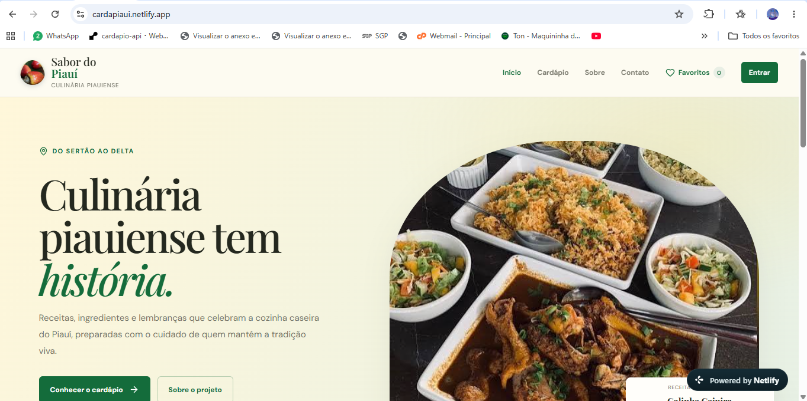
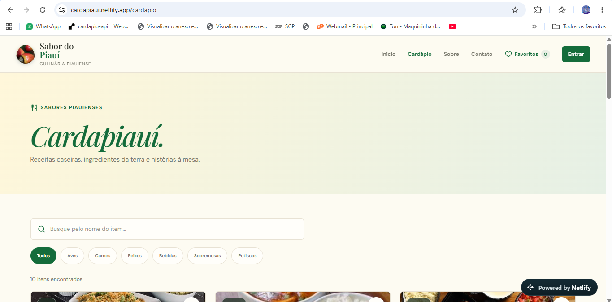
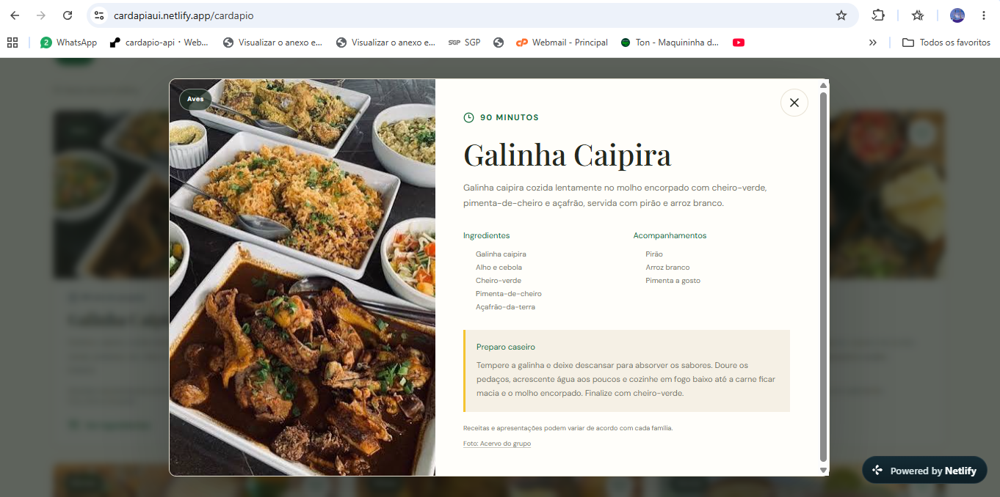
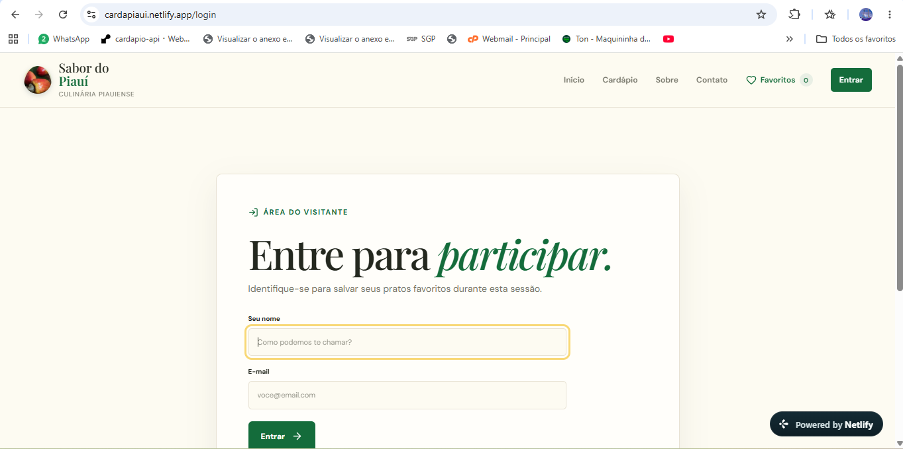
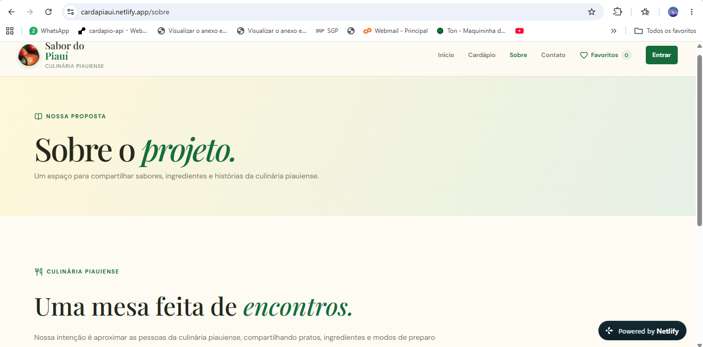
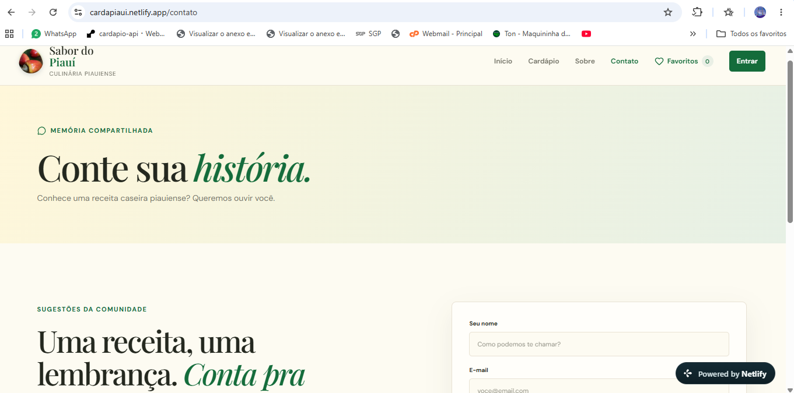
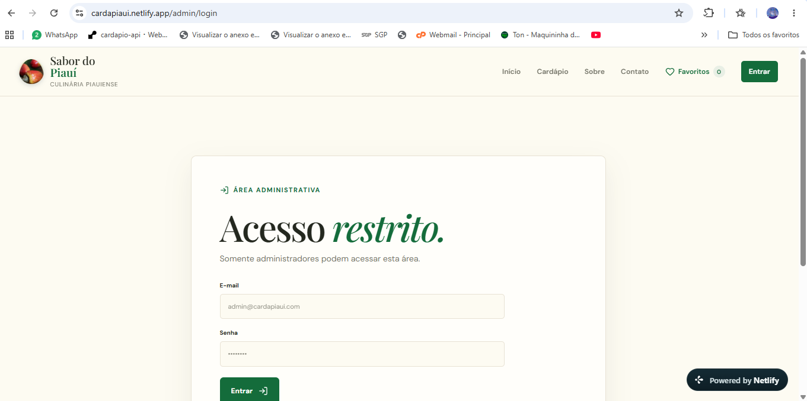

# Cardapiaui — Frontend

Aplicação web sobre a gastronomia caseira e tradicional do Piauí. Apresenta receitas, ingredientes, modos de preparo e acompanhamentos, com integração real a uma API REST e área administrativa protegida.

🌐 **Demo:** [https://cardapiaui.netlify.app](https://cardapiaui.netlify.app)  
🔗 **API:** [https://cardapio-api-8p32.onrender.com](https://cardapio-api-8p32.onrender.com)

---

## Tecnologias

- React 19 + TypeScript com Vite
- Tailwind CSS v4
- React Router v7
- Lucide React

---

## Instalação e execução local

Requisitos: Node.js 18+ e npm.

```bash
# 1. Instale as dependências
npm install

# 2. Configure o ambiente
echo "VITE_API_URL=http://localhost:3001" > .env

# 3. Inicie o frontend
npm run dev
```

O Vite sobe em `http://localhost:5173`.

> Para funcionar localmente é necessário ter o backend rodando em `http://localhost:3001`.  
> Repositório do backend: [https://github.com/saymoonmota/cardapio-api](https://github.com/saymoonmota/cardapio-api)

Outros comandos:

```bash
npm run build    # gera a pasta dist para deploy
npm run lint     # verifica o código com oxlint
npm run preview  # serve o build localmente
```

---

## Variáveis de ambiente

| Variável        | Descrição                  | Padrão                   |
|-----------------|----------------------------|--------------------------|
| `VITE_API_URL`  | URL base da API backend    | `http://localhost:3001`  |

Em produção (Netlify), configure essa variável em **Site settings → Environment variables**.

---

## Páginas

| Caminho         | Página       | Descrição                                              |
|-----------------|--------------|--------------------------------------------------------|
| `/`             | Início       | Banner com prato destaque e vitrine de receitas        |
| `/cardapio`     | Cardápio     | Busca, filtros por categoria, favoritos e modal        |
| `/login`        | Login        | Identificação do visitante para salvar favoritos       |
| `/sobre`        | Sobre        | Proposta do projeto e valorização da culinária piauiense |
| `/contato`      | Contato      | Formulário de sugestão de receitas (salvo na API)      |
| `/admin/login`  | Admin Login  | Acesso restrito ao painel administrativo               |
| `/admin`        | Dashboard    | Lista de sugestões recebidas (apenas admins)           |

---

## Área administrativa

Acesse `/admin/login` com as credenciais de administrador configuradas no backend.

Funcionalidades:
- Lista paginada de sugestões enviadas pelo formulário de contato
- Filtro por mensagens não lidas
- Marcar mensagens como lidas/não lidas
- Modal com detalhe completo de cada sugestão
- Sessão persistida no `localStorage` com validação automática do token JWT

---

## Estrutura de pastas

```
src/
├── components/       # Navbar, Footer, cards, modal, formulários, PrivateRoute
├── context/          # AppContext — pratos, usuário, admin, favoritos
├── pages/            # Home, Cardapio, Login, Sobre, Contato, AdminLogin, AdminDashboard
├── services/         # api.ts — fetch para pratos, contatos e auth
├── types/            # Interfaces e tipos compartilhados
├── App.tsx           # Rotas e layout geral
├── App.css           # Estilos dos componentes
├── index.css         # Estilos globais e tema Tailwind
└── main.tsx          # Ponto de entrada React
```

---

## 🖼️ Prints das Telas

### Página Inicial (Home)


### Cardápio


### Modal de Prato


### Login


### Sobre


### Contato


### Painel Administrativo


---

## Integrantes e componentes

| Integrante | Componente 1 | Componente 2 |
|---|---|---|
| Saymoon Wanderson Sousa Mota | `AppContext` | `AdminDashboard` |
| Francisco Vitor Santos Lima | `Navbar` | `PratoModal` |
| Antonio Jose Barros Silva Filho | `ContactForm` | `PratoCard` |
| Marcos Aurelio | `LoginForm` | `SearchFilter` |
| Mayson de Tacio | `HeroBanner` | `PratoGrid` |

| Categoria    | Pratos                                          |
|--------------|-------------------------------------------------|
| Aves         | Galinha Caipira                                 |
| Carnes       | Panelada Piauiense, Carne de Bode, Carne de Sol, Sarapatel |
| Peixes       | Piau Frito                                      |
| Bebidas      | Cajuína Piauiense                               |
| Sobremesas   | Doce de Buriti, Doce de Caju                    |
| Petiscos     | Castanha Assada                                 |

---

## Deploy (Netlify)

O repositório está conectado à Netlify com deploy automático a cada push na branch `main`.

Configuração em `netlify.toml`:
- **Build command:** `npm run build`
- **Publish directory:** `dist`
- **Redirects:** todas as rotas apontam para `index.html` (necessário para o React Router)
